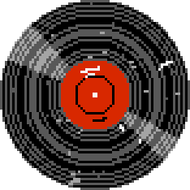
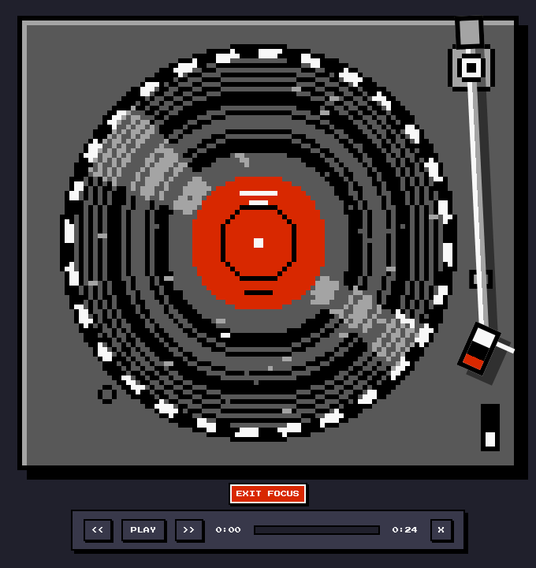
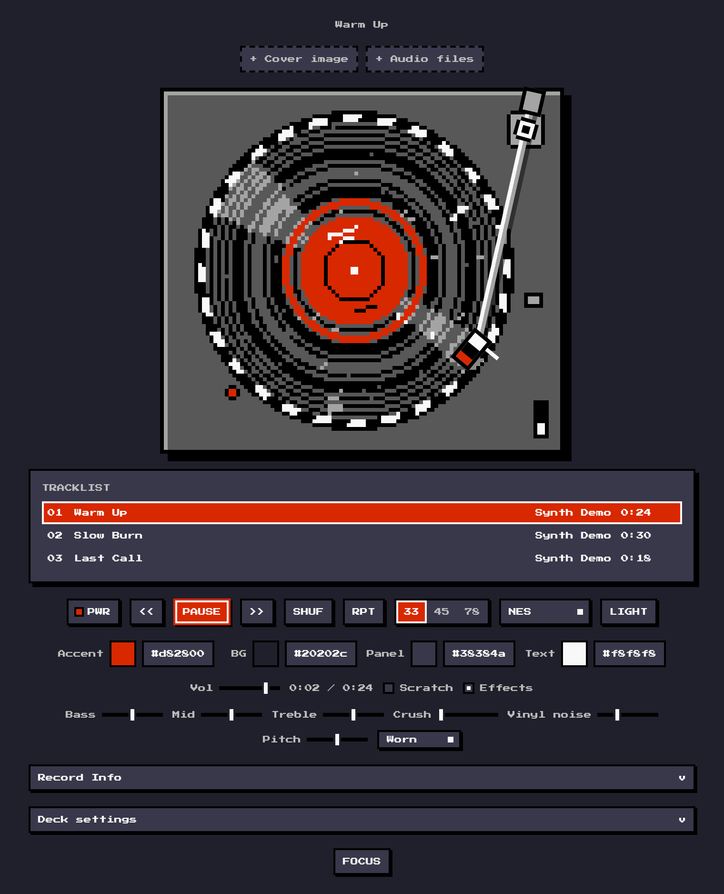
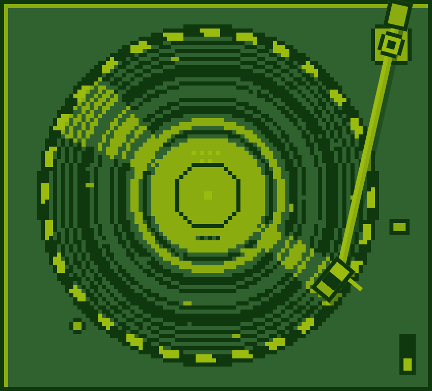
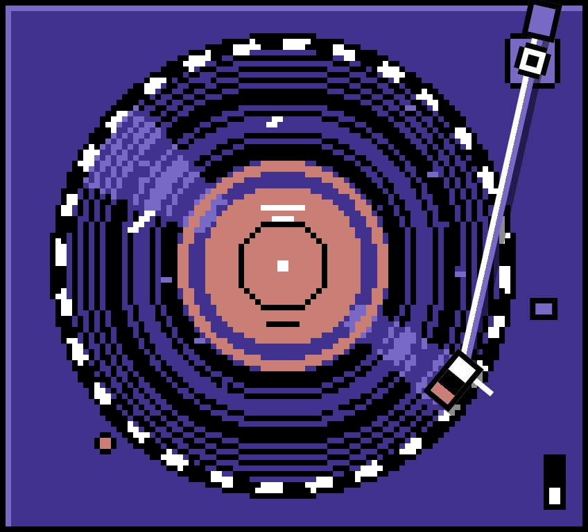

<div align="center">



# 8-Bit Vinyl Player

**A pixel-art turntable in one HTML file. It plays your own audio files, in the colours of an NES, a Game Boy or a C64.**

[Run it](#run-it) · [What is 8-bit](#what-is-8-bit) · [Controls](#controls) · [Limits](#limits)




</div>

The Realistic Vinyl Player redrawn as pixel art. The deck underneath is the same: the platter spins up and coasts down, the tonearm tracks across the whole record, and the pitch follows the platter speed. What changed is how it looks and, if you turn up the Crush fader, how it sounds. The "try it" link loads three short demo tracks.

<div align="center">

</div>

| Game Boy | C64 |
|---|---|
|  |  |

## Run it

Open `index.html` in a browser. That is all: no build step, nothing to install, no network requests. It works offline and from `file://`.

Add `?demo` to the URL to load three short synthesized tracks, so you can try it without any files. Demo tracks are kept in memory and never touch your saved library.

To preview it the way the website serves it, run this in the repository folder and open <http://localhost:8000/>:

```
python3 -m http.server 8000
```

## What is 8-bit

**Look**

- The platter is 84 deck pixels wide. On a desktop one deck pixel is exactly 4 screen pixels (6 in focus mode, 3 on a phone).
- The deck and the record use four shades and one accent colour. Three palettes: NES (greys and red), Game Boy (four greens), C64 (blues). Each has a light and a dark page.
- The record is not a picture that gets rotated. Its grooves are rings, which look the same at every angle, so they stay put; only the cover, the label print, scratches and dust are moved, to one of 64 angles per turn. No pixel is ever drawn tilted or between two others.
- Grooves are brighter where the music is louder, tracks are separated by two dark rings, and two highlights stay fixed in the room while the record turns under them.
- A cover image is drawn on the label in the five palette colours, dithered.
- Text is set in Press Start 2P, embedded in the file. Animations move in steps.

**Sound**

- Crush reduces the bit depth and the sample rate of everything you hear: from 8 bits at 22 kHz just above zero, down to 4 bits at 5.5 kHz at the top. At zero the signal is untouched. It is off until you move it.
- Cue lever, arm, needle drop, motor, speed switch and record placement are square waves, triangle waves and noise, like the channels of a sound chip.

<details>
<summary><strong>Kept from the Realistic Vinyl Player</strong></summary>

- Platter speed is exact: 33⅓ rpm is 200°/s, 45 is 270°/s, 78 is 468°/s. The motor takes about 1.4 s to reach speed and the platter coasts for about 3 s.
- The tonearm is a pivoted arm. Its angle comes from the pivot geometry (law of cosines), so the stylus traces the arc a real arm would.
- The record holds the whole playlist. Tracks are groove bands sized by their duration, with gaps between them, a lead-in at the edge and a run-out with a locked groove near the label.
- Play starts the motor and lowers the stylus. Pause lifts it. Track changes lift, swing and lower in under a second.
- Drag the tonearm and drop it on a groove to play from there. Drop it on a gap for the next track's start, or off the record to park it.
- Put a hand on the record to scrub. On release it slips against the mat and catches the platter in about a quarter of a second.
- At the end of the record the stylus runs into the locked groove, thumps once per turn, then the arm returns.
- Optional: record sides of about 22 minutes, with a flip. Optional: record size follows speed (a 7-inch single on an adapter at 45, a 10-inch at 78).
- Pitch follows platter speed everywhere: spin-up, spin-down, the 45 and 78 settings, the ±8% pitch fader, and wow and flutter.
- Scratch mode plays the real track under your hand, forwards and backwards.
- After the EQ the signal gets what a cut record gives it: mono bass below 120 Hz, −25 dB channel crosstalk, a high-frequency roll-off and a little soft saturation.
- Surface noise is generated, not looped. Each record has its own scratches, which tick once per turn at the place where they are drawn.
- The strobe marks on the platter rim stand still at the right speed and drift when the pitch is off.

</details>

## Controls

| Control | What it does |
|---|---|
| PWR | Motor on or off. With the stylus down, the music winds up or down with the platter. |
| << PLAY >> | Previous, play or pause, next |
| SHUF, RPT | Shuffle; repeat off, one, all |
| 33 / 45 / 78 | Platter speed (33 is 33⅓) |
| Palette, LIGHT / DARK | NES, Game Boy or C64; light or dark page |
| Accent, BG, Panel, Text | Custom colours (these override the light/dark toggle). Choosing a palette resets them. |
| Vol, Bass, Mid, Treble | Volume and three-band EQ |
| Crush | 8-bit sound: fewer bits and a lower sample rate the further you push it. Zero is clean. |
| Scratch | Hear the record while you turn it by hand |
| Effects | Mechanical sounds on or off |
| Vinyl noise | Level of everything the record surface adds |
| Pitch | ±8%. Double-click to reset. |
| Condition | Mint, Good, Worn or Beat-up: hiss, crackle, scratches, dust and treble loss |
| Cue lever, tonearm click | Lift or lower the stylus; the motor keeps running |
| Record Info | Tags for the current track and editable liner notes |
| Deck settings | Imperfection (wow and flutter), keep the platter spinning when paused, auto-return, record sides, record size follows speed, keep playing with the screen locked, and the graphic EQ |
| Graphic EQ | Winamp's ten bands and preamp after the tone controls, its 17 presets and loading of Winamp `.eqf` preset files. Off by default; a trim ahead of it takes back any boost so it does not clip. Its settings and imported presets are shared with the Realistic Vinyl Player and the other players when they are served from the same address, or opened as local files in the same browser. |
| FLIP A | Flip the record. Shown beside the tracklist heading when "Record sides" is on and the playlist needs more than one side. Choosing a track on another side flips it for you. |
| FOCUS | Larger deck with a floating control bar |
| VIZ | A visualizer on the record label while a record plays, in place of the cover. Each press steps on: off, MilkDrop, spectrum bars, lines (a ridgeline), scope, spectrogram, ring (a radial spectrum). It stays upright as the record turns. All but MilkDrop are drawn on the deck's grid in the palette. |
| DESK | The library as a desktop: artists and albums open as folders in movable windows. Double-click a track, or drag it onto the Turntable icon, to play it. Esc closes the front window, then the desktop. |
| Media keys | Play, pause, previous, next and seek from the keyboard's media keys or a headset |

Drag audio files or a cover image onto the page to add them.

### Keyboard

| Key | Action |
|---|---|
| Space | Play or pause |
| ← / → | Back or forward 5 s. ← near the start of a track goes to the previous track. |
| ↑ / ↓ | Volume |
| S | Shuffle |
| R | Repeat |
| F | Focus mode |
| Esc | Leave focus mode |

## Privacy

Everything stays on your device. Audio files, cover art and notes are stored in your browser's IndexedDB (`vinyl-db`); settings are in `localStorage`. The page makes no network requests.

The saved data is shared with the Realistic Vinyl Player when both are served from the same address (for example two project sites on one GitHub Pages account). Your library, colours, volume, EQ and deck settings then show up in both. The palette chosen here and the theme chosen there are stored separately, so neither replaces the other. The colours are shared, though: choosing a palette here sets its accent and clears custom BG, Panel and Text colours, and the Realistic Vinyl Player then shows that accent too. A custom colour picked in either player shows in both.

## Limits

- The tonearm, plinth and controls are flat blocks placed with CSS, not pixels on the deck's grid. The arm turns at an angle, so its edges are not grid-aligned.
- Where the browser has no CSS `round()` (before 2024), or on screens between sizes, a deck pixel is not a whole number of screen pixels and some look a little wider than others.
- There is no text on the record label: it is about 28 pixels across. Artist, album and year are in Record Info.
- A cover is reduced to five colours. Photographs come out rough, most of all in the Game Boy palette.
- MilkDrop needs WebGL 2; without it the VIZ button offers the bars alone. MilkDrop is drawn at three pixels per deck pixel (about 78 across on an LP), finer than the rest of the deck, in its own colours, not the palette's five, and its edge is a smooth circle. The bars keep to the grid and the palette: ten of them on an LP's label, an octave each. Both stay off under `prefers-reduced-motion`. Butterchurn's code is about half of the file.
- Crush is a bit and sample-rate reducer, not a chiptune synthesizer: the music keeps its own instruments. It needs AudioWorklet; without it the fader is disabled.
- Press Start 2P covers Latin, Greek and Cyrillic. Other scripts in track titles fall back to the monospace font of the device.
- Tracks longer than 20 minutes, and files the browser cannot decode into memory, play through the plain media element. They still follow platter speed and pitch, but they scrub silently, cannot play backwards and do not get wow and flutter. In Safari that path cannot glide: the music starts once the platter is at speed and stops when the motor is switched off.
- A decoded track is held as 16-bit samples: about 0.18 MB of memory per second of stereo audio, and twice that for a moment while it is being decoded. Only the current track and the next one are held.
- Tags and cover art are read from MP3 (ID3 v1, v2.3, v2.4), FLAC, M4A/MP4, Ogg Vorbis, Opus and WAV files. Other formats play, without tags.
- On touch devices the sound is sent through a media element, so that a locked phone keeps playing and shows lock-screen controls. This has not been confirmed on a real phone yet. "Keep playing with the screen locked" in Deck settings turns it off, or on for a desktop.

## Development

There is nothing to build to run it. Two URL switches help with testing:

- `?selftest` checks the arm geometry, the track-to-groove mapping, the side packing, the tag parsers and that the record is drawn in palette colours only, and logs `selftest ok`.
- `?debug` exposes the deck state as `window.__deck`.

The checks in `test/` drive the page in Chromium, Firefox and WebKit with Playwright. Playwright is a development dependency of the tests only.

```
cd test
npm ci && npx playwright install
npm run lint          # syntax, no outside resources, no debug leftovers, links
npm run build         # assembles the published site in _site/
npm test              # behaviour, in all three browsers
npm run test:audio    # pitch, glide, aliasing and click measurements (prints a report)
npm run shots         # screenshots of every palette, light and dark, desktop and phone, in test/out/shots/
```

Versions are pinned: Playwright in `test/package.json`, Node and the GitHub Actions in `.github/workflows/`.

All tunable constants (the pixel grid, the Crush range, record dimensions, spin-up and coast times, noise levels, arm timings) are in one block at the top of the script in `index.html`. The palettes are CSS variables at the top of the stylesheet.

## Deploy

The site is static. Every push to `main` runs `.github/workflows/pages.yml`, which copies `index.html`, `favicon.png`, `OFL.txt`, `llms.txt`, `sitemap.xml` and `screenshots/` into `_site/` and publishes that folder to GitHub Pages. To set it up: Settings → Pages → Source: GitHub Actions, and keep "Enforce HTTPS" on.

For a custom domain, add a `CNAME` file with the domain to the published folder (copy it in the `build` script in `test/package.json`) and set the domain under Settings → Pages.

## Contributing

Bug reports, ideas and pull requests are welcome. Read [CONTRIBUTING.md](CONTRIBUTING.md) first; it covers how to run the checks and the few rules that keep the player a single offline file. Everyone taking part is expected to follow the [Code of Conduct](CODE_OF_CONDUCT.md). Report security problems privately, as described in [SECURITY.md](SECURITY.md).

## Changes

See [CHANGELOG.md](CHANGELOG.md).

## Licence and attributions

Code: [MIT](LICENSE).

- The font is [Press Start 2P](https://github.com/codeman38/PressStart2P), copyright 2012 The Press Start 2P Project Authors, embedded unmodified in `index.html` under the [SIL Open Font License 1.1](OFL.txt). It is not covered by the MIT licence. See [NOTICE](NOTICE).
- The MilkDrop visualizer is [butterchurn](https://github.com/jberg/butterchurn) 2.6.7 with the "minimal" pack of [butterchurn-presets](https://github.com/jberg/butterchurn-presets) 2.4.7, copyright 2013-2018 Jordan Berg, embedded unmodified in `index.html` under the MIT licence. The licence text is in the file, above that code. The presets are community MilkDrop presets converted for butterchurn; each is named after its authors. See [NOTICE](NOTICE).
- The bars visualizer follows [Musializer](https://github.com/tsoding/musializer) (MIT licence, copyright 2023 Alexey Kutepov and Musializer Contributors): its spectrum analysis and its bars, dots and smears, rewritten for the browser and the deck's grid. See [NOTICE](NOTICE).
- The graphic EQ uses the band layout and the 17 built-in preset values of [Webamp](https://github.com/captbaritone/webamp) (MIT licence, copyright 2015 Jordan Eldredge), and its `.eqf` reader is written from Webamp's format notes. No Winamp skin or artwork is used. Winamp is a trademark of its owner; this project is not affiliated with Winamp, Nullsoft or Webamp. See [NOTICE](NOTICE).
- The library desktop follows the idea of [Winampify](https://github.com/remigallego/winampify) (MIT); the Lines, Scope, Spectrogram and Radial visualizers are ideas found through [awesome-audio-visualization](https://github.com/willianjusten/awesome-audio-visualization) (CC0). No code was taken from either. See [NOTICE](NOTICE).
- No other third-party code, images, icons or audio are included. Every drawing is generated in the page and the demo tracks are synthesized.
- Screenshots in `screenshots/` show the demo tracks only.
- "NES", "Game Boy" and "C64" name the colour palettes. This project is not affiliated with or endorsed by Nintendo or the owners of the Commodore brand.
- The [Code of Conduct](CODE_OF_CONDUCT.md) is the [Contributor Covenant 2.1](https://www.contributor-covenant.org/version/2/1/code_of_conduct/), used under [CC BY 4.0](https://creativecommons.org/licenses/by/4.0/).
- The deck model, audio engine and tag parsers come from the Realistic Vinyl Player, and its layout from the original [Vinyl-Player](https://github.com/Gitguy268/Vinyl-Player), both by the same author.
